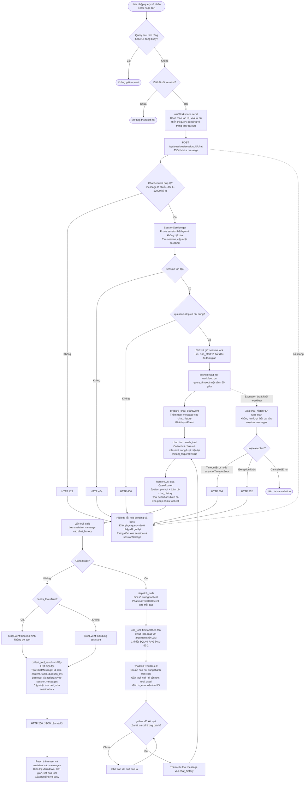
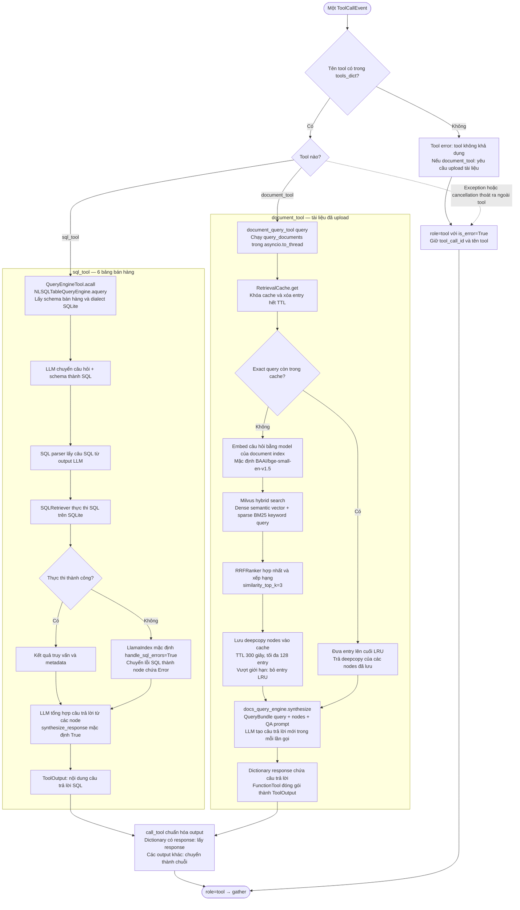
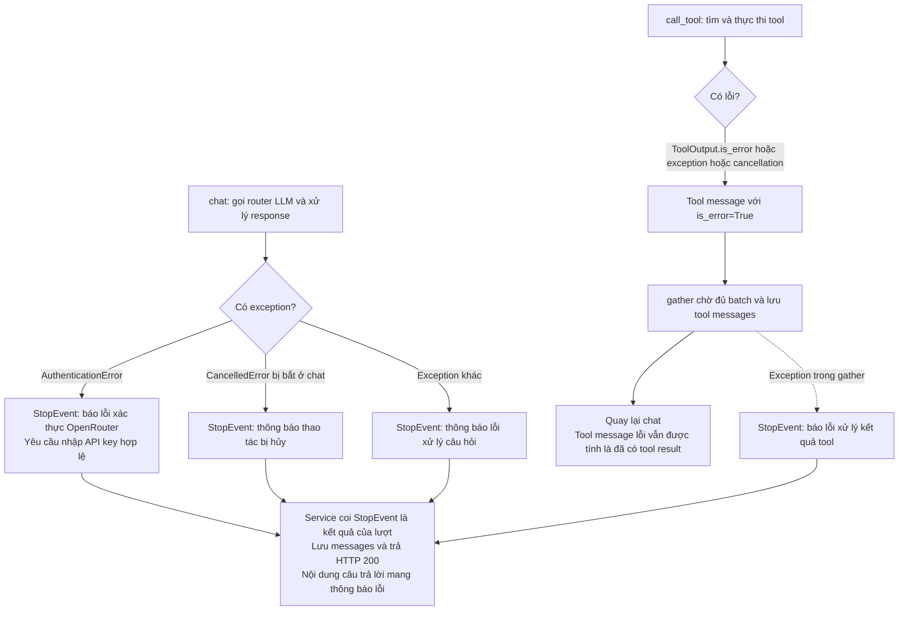

# Luồng xử lý query từ người dùng

Sơ đồ mô tả code ứng dụng hiện tại trong `frontend/src/` và `backend/`, bao gồm các thay đổi đang có trong workspace. `app.py` chỉ xuất FastAPI app; notebook và `workflow_all_flows.html` không phải entry point của ứng dụng hiện tại.

## 1. Từ UI đến câu trả lời

`prepare_chat` còn kiểm tra `message is None` và ném `ValueError`; đường HTTP hợp lệ đã có `ChatRequest`, nên bình thường không tới nhánh này.

## 2. Bên trong từng tool

Mỗi tool call chọn một tool theo tên; một batch có thể chứa SQL, document hoặc cả hai. Tool call dùng câu hỏi/arguments do router LLM sinh, không nhất thiết dùng nguyên văn query UI.

Lỗi retrieval không được cache; retrieval thành công nhưng không có nodes vẫn được cache. Cache thuộc một document index, nên upload thành công tạo tool/index/cache mới. SQL dùng `SQLOnlyEmbedding` để tắt vector embedding, không đi qua Milvus.

## 3. Lỗi được bắt bên trong workflow

## Những điều cần đọc đúng trên sơ đồ

- Session mới luôn có `sql_tool`; `document_tool` chỉ xuất hiện sau upload và xây index thành công. Upload/indexing là bước chuẩn bị riêng, không chạy lại trong mỗi query.
- Router phân loại bằng LLM và tool descriptions/system prompt. Không có `if` kiểm tra keyword để quyết định SQL hay RAG. Prompt yêu cầu dùng lịch sử để tạo câu hỏi tự đủ ngữ cảnh và giữ ngôn ngữ của user; đây là hướng dẫn cho LLM.
- `needs_tool` dựa trên việc có tool và có role=`tool` trong lượt hiện tại. Khi có tool, lần gọi router đầu tiên bị yêu cầu gọi tool cho mọi query. Kết quả tool của lượt cũ không bỏ qua yêu cầu này; tool message lỗi trong lượt hiện tại vẫn làm yêu cầu này chuyển thành False.
- Mọi batch kết quả tool đều quay lại router. Router có thể đọc chính sách qua RAG rồi gọi SQL, hoặc đọc đơn hàng qua SQL rồi tra chính sách; chỉ trả lời khi đủ dữ kiện hoặc báo thông tin còn thiếu.
- Không có bước kiểm tra điểm tin cậy, ngưỡng relevance hay nhánh `if context đủ` trong application code. QA prompt yêu cầu LLM chỉ dùng context và báo thiếu thông tin. SQL error được thư viện chuyển thành node không tự động có `ToolOutput.is_error=True`.
- `dispatch_calls` phát nhiều event, không tự `asyncio.gather`. Bản workflow library đang cài mặc định có 4 worker mỗi step, nên có thể xử lý tool call đồng thời. `gather` chờ đủ số lượng call trong batch.
- Không có giới hạn số vòng agent/tool call trong code này. Workflow và `asyncio.wait_for` cùng dùng `query_timeout` (mặc định 60 giây). Thời gian chờ `session.lock` nằm ngoài đồng hồ này và ngoài `duration_ms`.
- HTTP 504 chỉ áp dụng khi service bắt `TimeoutError`/`asyncio.TimeoutError`. `WorkflowTimeoutError` của thư viện đang cài kế thừa `Exception`; nếu lỗi này thoát ra trước outer timeout, service trả 502 theo nhánh exception khác.
- API trả một JSON sau khi hoàn thành; không có streaming token. Lỗi được workflow đổi thành `StopEvent` thường vẫn trả 200; exception thoát khỏi workflow mới đi nhánh rollback/HTTP error.

## Nguồn code

| Phần | File / hàm |
| --- | --- |
| Submit, pending, render kết quả | `frontend/src/components/ChatView.jsx`: `submit`, `Answer` |
| Khóa thao tác, gọi API, xử lý lỗi | `frontend/src/hooks/useWorkspace.js`: `perform`, `send` |
| HTTP client | `frontend/src/lib/api.js`: `request`, `api.chat` |
| Endpoint và validation | `backend/api.py`: `chat`; `backend/schemas.py`: `ChatRequest`, `ChatMessage` |
| Session, lock, timeout, rollback | `backend/service.py`: `get`, `chat`, `create`, `upload` |
| Vòng agent và tổng hợp kết quả | `backend/rag/workflow.py`: `prepare_chat`, `chat`, `dispatch_calls`, `call_tool`, `gather` |
| SQL/RAG engine và QA prompt | `backend/rag/tools.py`: `setup_sql_tool`, `setup_document_tool`, `document_query_tool` |
| Cache context | `backend/rag/retrieval_cache.py`: `RetrievalCache.get` |
| Tắt embedding cho SQL | `backend/rag/sql_embedding.py`: `SQLOnlyEmbedding` |
| Metadata của lượt hiện tại | `backend/serialization.py`: `collect_tool_results` |
| Mặc định và cấu hình môi trường | `backend/config.py`: `AppConfig` |
| SQL engine/retriever thực tế | `.venv/Lib/site-packages/llama_index/core/indices/struct_store/sql_query.py`, `sql_retriever.py` |
| Tool SQL và worker/timeout của library | `.venv/Lib/site-packages/llama_index/core/tools/query_engine.py`, `.venv/Lib/site-packages/workflows/decorators.py`, `errors.py` |

Đây là tài liệu từ việc đọc source và dependency đang cài, không phải báo cáo chạy query live với OpenRouter/Milvus.
